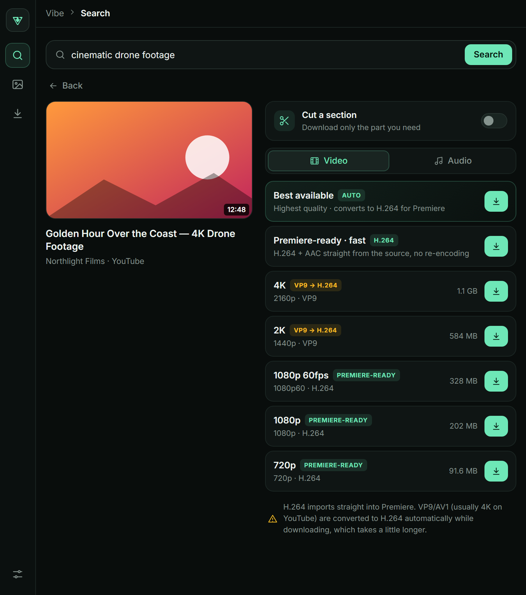
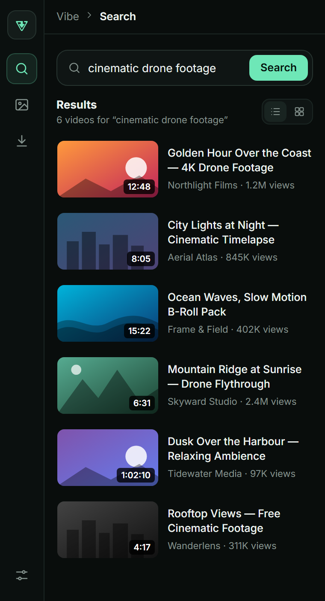
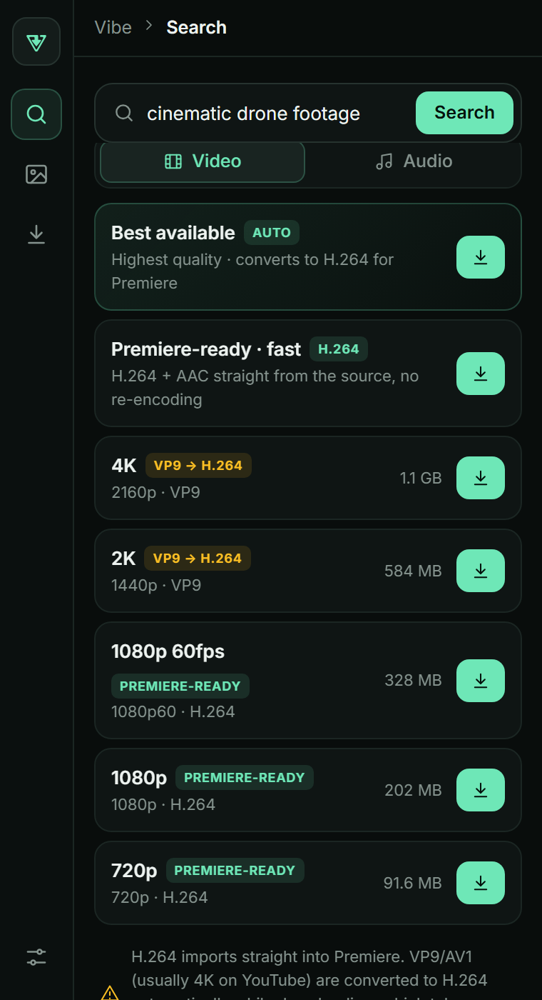
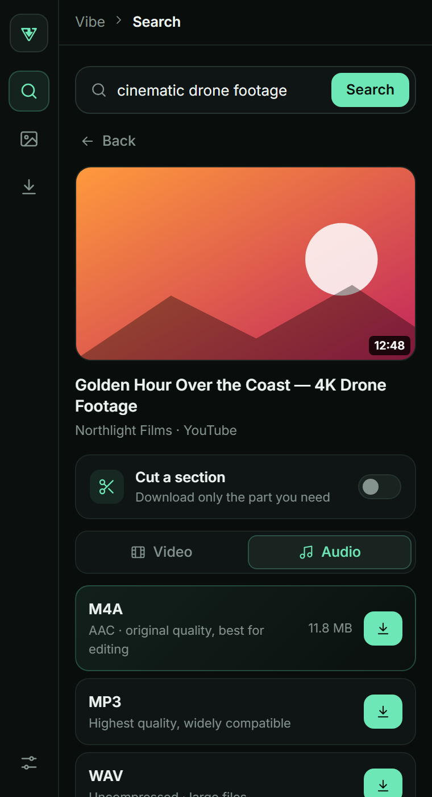
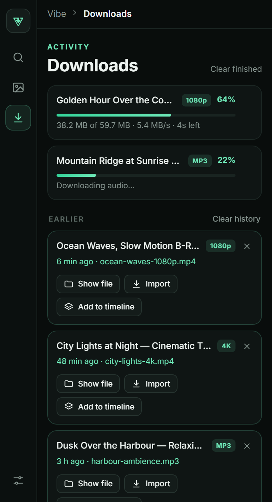
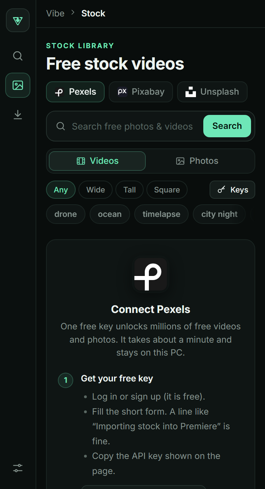
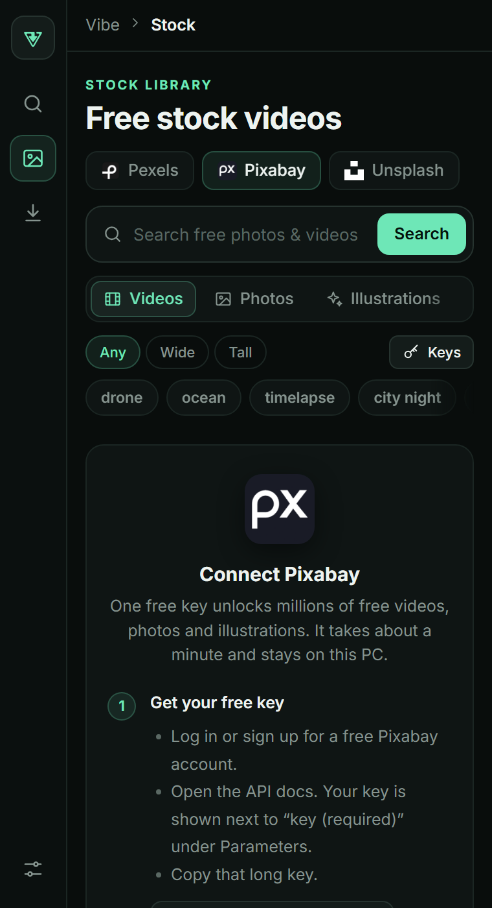
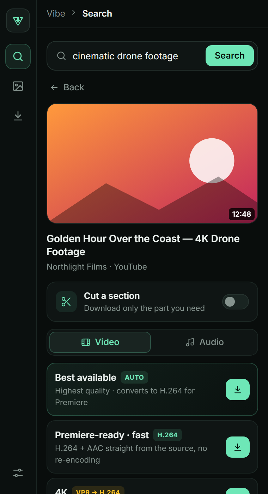
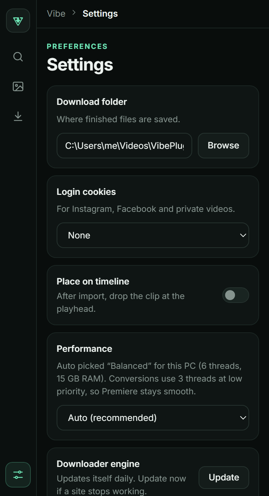
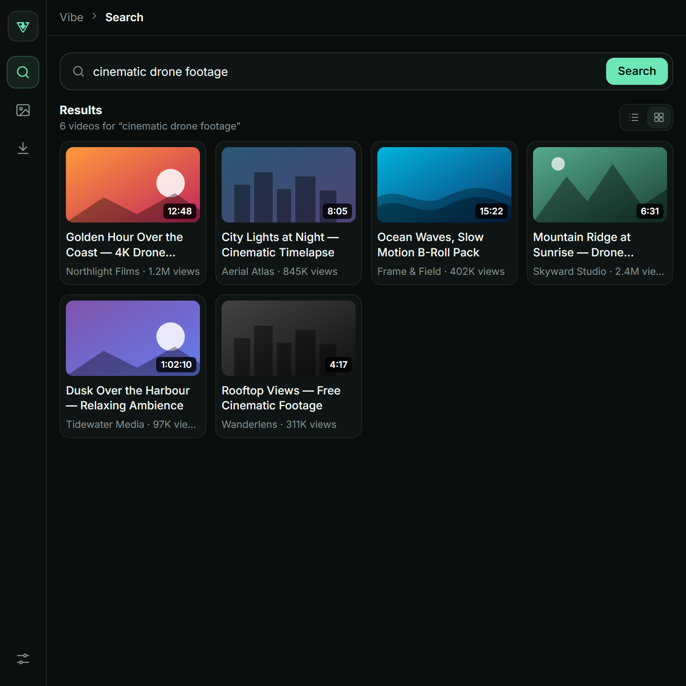

<div align="center">
  <a href="https://github.com/naeem5877/vibe-plugin">
    
  </a>
  <br />
  <br />

  <h1>Vibe Plugin</h1>

  <p>
    <strong>An open-source YouTube &amp; social video downloader that lives inside Adobe Premiere Pro.</strong>
  </p>

  <p>
    Search YouTube or paste a link, pick a quality, and the file lands in your project bin (or straight on your timeline) — as Premiere-ready H.264. Powered by <code>yt-dlp</code>, running locally, ad-free, with no accounts.
  </p>

  <p>
    <a href="https://github.com/naeem5877/vibe-plugin">
      
    </a>
    <a href="https://github.com/naeem5877/vibedownloader-desktop">
      
    </a>
    <a href="https://vibedownloader.me">
      
    </a>
  </p>

  <p>
    <a href="https://github.com/naeem5877/vibe-plugin/releases/latest">
      
    </a>
    <a href="https://github.com/naeem5877/vibe-plugin/releases">
      
    </a>
    <a href="LICENSE">
      
    </a>
  </p>
<br />

[Features](#features) · [Screenshots](#screenshots) · [Install](#install) · [Develop](#develop)

</div>

<br />

---

## 🌟 Why Vibe Plugin?

Editors lose a surprising amount of time bouncing between a browser, a downloader, a file manager and Premiere. Vibe Plugin collapses that into one panel: **search → pick → it's in your project.**

Everything runs **on your machine**. There is no server of ours in the middle, no account, and no tracking.

<div align="center">

### 🚫 No Accounts • 🔒 Private by Design • ⚡ Instant Info • 🎬 Premiere-Ready

</div>

---

<a id="screenshots"></a>

## 🖼️ Screenshots

<table>
<tr>
<td colspan="2" align="center"><br /><sub><b>Pick a quality — VP9/AV1 converts to Premiere-ready H.264 while it downloads</b></sub></td>
</tr>
<tr>
<td width="50%" align="center"><br /><sub><b>Search YouTube or paste a link</b></sub></td>
<td width="50%" align="center"><br /><sub><b>Every resolution, with size &amp; codec at a glance</b></sub></td>
</tr>
<tr>
<td width="50%" align="center"><br /><sub><b>Audio — M4A, MP3 or WAV</b></sub></td>
<td width="50%" align="center"><br /><sub><b>Downloads — live progress, then one-click Import or Add to timeline</b></sub></td>
</tr>
<tr>
<td width="50%" align="center"><br /><sub><b>Stock library — Pexels, Pixabay &amp; Unsplash</b></sub></td>
<td width="50%" align="center"><br /><sub><b>Free stock video, music &amp; sound effects</b></sub></td>
</tr>
<tr>
<td width="50%" align="center"><br /><sub><b>Fits a narrow docked panel</b></sub></td>
<td width="50%" align="center"><br /><sub><b>Settings — download folder &amp; login cookies</b></sub></td>
</tr>
<tr>
<td colspan="2" align="center"><br /><sub><b>Results as a list or a grid — scales with the panel</b></sub></td>
</tr>
</table>

<sub>Screenshots use placeholder titles and channel names.</sub>


<a id="features"></a>

## ✨ Key Features

<table>
<tr>
<td width="50%" valign="top">

### 🔎 Search & Paste
Search YouTube right in the panel, or paste a link from YouTube, Instagram, TikTok, Facebook, X, Vimeo or Reddit. Pasting a link opens it immediately

### ⚡ Super-Fast Video Info
For single YouTube videos the panel talks to YouTube's InnerTube API directly, so formats appear in **a fraction of a second** instead of waiting several seconds for a full `yt-dlp` run. Anything it isn't sure about quietly falls back to `yt-dlp`

### 🎞️ Premiere-Ready by Default
VP9 / AV1 (what YouTube serves at 4K) are converted to **H.264 + AAC in an MP4** while downloading, so Premiere imports them without trouble

### ✂️ Cut a Section
Download only the part you need with a filmstrip trimmer — frame-accurate, re-encoded to H.264

</td>
<td width="50%" valign="top">

### 📥 One-Click Import
Finished files go into a **"Vibe Downloads"** bin in your project. Optionally drop the clip at the playhead on the first free track

### 💬 Subtitles & Audio Languages
Download any caption track as **SRT** or **VTT**. Dubbed videos get an **audio-language picker**, for video or audio-only

### 🎵 Audio Formats
M4A (original quality), MP3 or WAV from any video

### 🧠 Kind to Your PC
Auto-tunes threads and presets to your hardware, runs one conversion at a time, and drops FFmpeg to low priority so **Premiere keeps the CPU**

### 🔄 Self-Maintaining
Installs and updates `yt-dlp` for you (daily, in the background)

</td>
</tr>
</table>

---

## 📋 Requirements

| | |
|---|---|
| **Adobe Premiere Pro** | 14.0 (2020) or newer |
| **OS** | **Windows** is the primary, tested platform. macOS is experimental (see [notes](#-macos-notes)) |
| **Internet** | Needed for downloads, and once on first run to fetch the helper tools |

On first use the panel downloads its helper tools into `%APPDATA%\VibePlugin\bin` — **`yt-dlp`**, **QuickJS** (a 2 MB JS engine for YouTube's challenges) and, only when a conversion or merge needs it, **FFmpeg**. Nothing is bundled in this repository.

---

<a id="install"></a>

## 📥 Installation

Grab the installer for your system from the [**latest release**](https://github.com/naeem5877/vibe-plugin/releases/latest):

<div align="center">

<a href="https://github.com/naeem5877/vibe-plugin/releases/latest"></a>
<a href="https://github.com/naeem5877/vibe-plugin/releases/latest"></a>
<a href="https://github.com/naeem5877/vibe-plugin/releases/latest"></a>

</div>

| Platform | File | What it does |
|---|---|---|
| 🪟 **Windows** | `vibe-plugin-vX.Y.Z-windows-setup.exe` | Per-user install, **no admin prompt**. Copies the panel to `%APPDATA%\Adobe\CEP\extensions\com.vibeplugin` and turns on unsigned panels. |
| 🍎 **macOS** *(experimental)* | `vibe-plugin-vX.Y.Z-macos.pkg` | Installs for every user under `/Library/Application Support/Adobe/CEP/extensions` and turns on unsigned panels for you. |
| 📦 **Any OS** | `vibe-plugin-vX.Y.Z-portable.zip` | The bare panel folder, for a manual install (steps below). |

Run the installer, **restart Premiere Pro**, then open **Window → Extensions → Vibe Plugin**.

> **"Windows protected your PC" / "can't be opened"?** The installers are unsigned. On Windows choose **More info → Run anyway**. On macOS right-click the `.pkg` and choose **Open**. Every release lists a `SHA256SUMS.txt` so you can verify the download.

The panel is an unsigned Adobe **CEP extension**, so Premiere has to be told to load it. The installers do that one-time step for you; the manual routes below show how to do it yourself.

### 💻 Windows — easiest (from source)

```bash
git clone https://github.com/naeem5877/vibe-plugin.git
cd vibe-plugin
install-dev.bat
```

`install-dev.bat` enables unsigned panels (`PlayerDebugMode` for CSXS 9–12) and links this folder into `%APPDATA%\Adobe\CEP\extensions\com.vibeplugin`. Then **restart Premiere Pro** and open **Window → Extensions → Vibe Plugin**.

Because it's a link, `git pull` updates the panel in place.

### 📦 Windows — from the portable ZIP

1. Download `vibe-plugin-vX.Y.Z-portable.zip` from the [**Releases page**](https://github.com/naeem5877/vibe-plugin/releases/latest)
2. Extract it to `%APPDATA%\Adobe\CEP\extensions\com.vibeplugin` (so `CSXS\manifest.xml` sits directly inside that folder)
3. Enable unsigned panels by running this once in a terminal:

   ```bash
   for %v in (9 10 11 12) do reg add HKCU\Software\Adobe\CSXS.%v /v PlayerDebugMode /t REG_SZ /d 1 /f
   ```
4. Restart Premiere Pro → **Window → Extensions → Vibe Plugin**

### 🍎 macOS notes

macOS support is **experimental**. `yt-dlp` and QuickJS install automatically, but there is no automatic FFmpeg install, so conversion, cutting, merging and MP3/WAV need an `ffmpeg` binary placed in `~/Library/Application Support/VibePlugin/bin/`.

```bash
chmod +x install-dev.sh && ./install-dev.sh
```

Please [open an issue](https://github.com/naeem5877/vibe-plugin/issues) with what you find — Mac testers are very welcome.

---

## 🚀 Usage

1. Open **Window → Extensions → Vibe Plugin**
2. Search for something, or paste a link
3. Choose **Video**, **Audio** or **Subtitles**, optionally open **Cut a section**, and press the download button
4. Watch progress in the **Downloads** tab — when it finishes it's imported automatically (or press **Import** / **Add to timeline**)

> **Tip:** press <kbd>/</kbd> anywhere in the panel to jump to the search box.

### ⚙️ Settings

| Setting | What it does |
|---|---|
| **Download folder** | Where files are saved (default `~/Videos/VibePlugin`) |
| **Login cookies** | Use your Chrome / Edge / Firefox / Brave login for Instagram, Facebook and private videos |
| **Place on timeline** | After import, drop the clip at the playhead |
| **Performance** | Auto, Gentle, Balanced, Fast or Maximum — how much CPU conversions may use |
| **Downloader engine** | Update `yt-dlp` now if a site stops working |

---

## ⚡ How the Fast Path Works

A normal `yt-dlp --dump-single-json` call takes several seconds. For a single YouTube video the panel instead:

1. Reuses a cached **visitor token** (minted once, stored locally)
2. Sends one request to the InnerTube `player` endpoint, plus a parallel one for category and upload metadata
3. Converts the answer into the same shape `yt-dlp` produces, so the format picker doesn't care which path answered

It has an 8-second ceiling and declines — handing over to `yt-dlp` — for playlists, live streams, age or login walls, DRM and anything that looks like a degraded format list. **Downloads themselves always go through `yt-dlp`.** Set `localStorage.vp_innertube = '0'` to switch the fast path off.

Subtitle lists and audio languages come from the same response; the caption and audio files themselves are fetched by `yt-dlp` when you press download.

---

## 🍪 Cookies (Optional)

Some content needs a signed-in session. Pick your browser under **Settings → Login cookies**.

- Cookies are read from your browser **on your computer** by `yt-dlp` and never leave it
- Plain, public YouTube videos don't need them

---

## 🧰 Troubleshooting

| Symptom | Try this |
|---|---|
| A site stopped working | **Settings → Downloader engine → Update** |
| "Script not loaded" when importing | Close and reopen the panel |
| Panel doesn't appear in the menu | Re-run `install-dev.bat` and fully restart Premiere |
| Low quality only / errors on YouTube | Update the engine, turn off any VPN, retry |
| Subtitles say "rate-limiting" | Wait a minute — YouTube throttles caption requests; the panel already retries |
| Premiere can't import a file | Use a format marked **PREMIERE-READY** or let VP9/AV1 convert to H.264 |

Still stuck? [Open an issue](https://github.com/naeem5877/vibe-plugin/issues) with your Premiere version, OS and a **public** link that fails.

---

## 🔐 Privacy

- Downloads, conversions and cookies are processed **locally**
- No accounts, ads, analytics or crash reporting in this repository
- The panel only talks to YouTube (search and video info), the sites you download from, and GitHub (to fetch `yt-dlp`, QuickJS and FFmpeg)
- Settings and recent searches are stored in the panel's local storage on your machine

---

<a id="develop"></a>

## 🛠️ For Developers

There is **no build step** — it's plain HTML, CSS and JavaScript running in Premiere's CEP panel (Chromium + Node.js), with a small ExtendScript bridge.

```bash
git clone https://github.com/naeem5877/vibe-plugin.git
cd vibe-plugin
install-dev.bat          # Windows  (./install-dev.sh on macOS)
```

Edit a file, then reload the panel (close and reopen it). To debug, open `http://localhost:8088` in Chrome while the panel is running (port set in `.debug`).

### Project Structure

```
vibe-plugin/
├── CSXS/manifest.xml     # CEP manifest (host, size, Node enabled)
├── index.html            # Panel UI shell
├── css/style.css         # Styling
├── js/
│   ├── main.js           # UI, search results, format picker, queue, Premiere import
│   ├── search.js         # YouTube search (InnerTube, WEB client)
│   ├── innertube.js      # ⚡ Fast path for single-video info
│   ├── tracks.js         # Subtitle + audio-language lists
│   ├── tools.js          # Installs/updates yt-dlp, QuickJS, FFmpeg; parses formats
│   ├── download.js       # Download runner, subtitle downloader, real progress
│   ├── trim.js           # "Cut a section" filmstrip trimmer
│   └── perf.js           # PC-aware conversion settings
├── jsx/host.jsx          # ExtendScript: import into bin / place on timeline
├── brand/                # Logo assets & brand guidelines
├── install-dev.bat       # Windows dev installer
└── test-innertube.js     # Live check for the fast path (node test-innertube.js [videoId])
```

### Quick Check

```bash
node test-innertube.js                 # default test videos
node test-innertube.js dQw4w9WgXcQ     # a specific video id
```

Please keep the source compatible with older CEP Chromium builds: stick to `const`/arrow functions/`async`, and avoid newer syntax such as optional chaining (`?.`).

---

### 🚢 Making a release

Releases are built by GitHub Actions ([`.github/workflows/release.yml`](.github/workflows/release.yml)):

1. Bump `ExtensionBundleVersion` (and the extension `Version`) in `CSXS/manifest.xml`, and add a `CHANGELOG.md` entry
2. Commit, then tag and push: `git tag v1.0.1 && git push origin v1.0.1`
3. The workflow checks the tag matches the manifest, syntax-checks the JavaScript, builds the Windows `.exe`, the macOS `.pkg` and the portable `.zip`, and publishes them with checksums

Run it by hand from **Actions → Release → Run workflow** to test the builds without publishing. To build an installer locally: `bash installer/stage.sh build/stage/com.vibeplugin`, then compile `installer/windows/vibe-plugin.iss` with [Inno Setup 6](https://jrsoftware.org/isinfo.php), or run `installer/macos/build-pkg.sh <version>` on a Mac.

## 🤝 Contributing

Contributions are welcome and appreciated!

1. **Fork** the repository
2. Create a **feature branch** (`git checkout -b feature/amazing-feature`)
3. **Commit** your changes (`git commit -m 'Add some amazing feature'`)
4. **Push** to the branch (`git push origin feature/amazing-feature`)
5. Open a **Pull Request**

Please read [CONTRIBUTING.md](CONTRIBUTING.md) and follow our [Code of Conduct](CODE_OF_CONDUCT.md).

### Areas We'd Love Help With

- 🍎 macOS testing and automatic FFmpeg setup
- 🎬 **DaVinci Resolve** and other NLE support (see the brand notes)
- 🐛 Bug fixes and stability improvements
- 🌐 Translations
- 📝 Documentation and screenshots

---

## 📄 License & Brand Usage

### Code License

This project is licensed under the **GNU GPL v3.0** — see [LICENSE](LICENSE).

You are free to view, modify and distribute the code, **provided that** you disclose the source, state your changes, and use the same GPL v3.0 license.

### Brand Notice

⚠️ **The "Vibe Plugin" / "VibeDownloader" name, logo and branding are reserved** (see [TRADEMARK.md](TRADEMARK.md)). The logo files in `brand/` are **not** covered by the GPL.

If you create a fork or modified version, please use a different name and logo, and don't present it as an official build.

### Third-Party Tools

Vibe Plugin does not bundle these; it downloads them at runtime. See [THIRD_PARTY.md](THIRD_PARTY.md) for details.

---

## ⚖️ Disclaimer

This tool is for downloading content **you own, have permission to use, or that is available under a license that allows it**. You are responsible for following the terms of service of the sites you use and the copyright laws that apply to you. The authors do not condone piracy. Vibe Plugin is not affiliated with, endorsed by, or sponsored by Adobe, Google/YouTube, or any other platform mentioned.

---

## 📞 Support & Community

- 🐛 **Found a bug?** [Open an issue](https://github.com/naeem5877/vibe-plugin/issues)
- 💡 **Have an idea?** [Start a discussion](https://github.com/naeem5877/vibe-plugin/discussions)
- 🔐 **Security issue?** See [SECURITY.md](SECURITY.md) — please don't file it publicly
- ⭐ **Like the project?** Give it a star — and check out the [desktop app](https://github.com/naeem5877/vibedownloader-desktop)

---

## 🙏 Acknowledgments

- Powered by [yt-dlp](https://github.com/yt-dlp/yt-dlp) — the downloader doing the heavy lifting
- [QuickJS-ng](https://github.com/quickjs-ng/quickjs) — tiny JS engine for YouTube's challenges
- [FFmpeg](https://ffmpeg.org/) via [yt-dlp/FFmpeg-Builds](https://github.com/yt-dlp/FFmpeg-Builds) — merging, converting and cutting
- [Adobe CEP](https://github.com/Adobe-CEP/CEP-Resources) — the extension platform

---

<div align="center">

### Made with ❤️ by [Naeem](https://github.com/naeem5877)

**If you find this project useful, consider giving it a ⭐**

<sub>© 2026 Vibe Plugin. Released under GPL v3.0 License.</sub>

</div>
